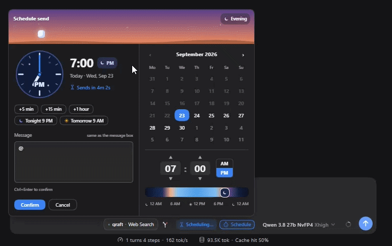
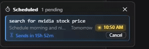
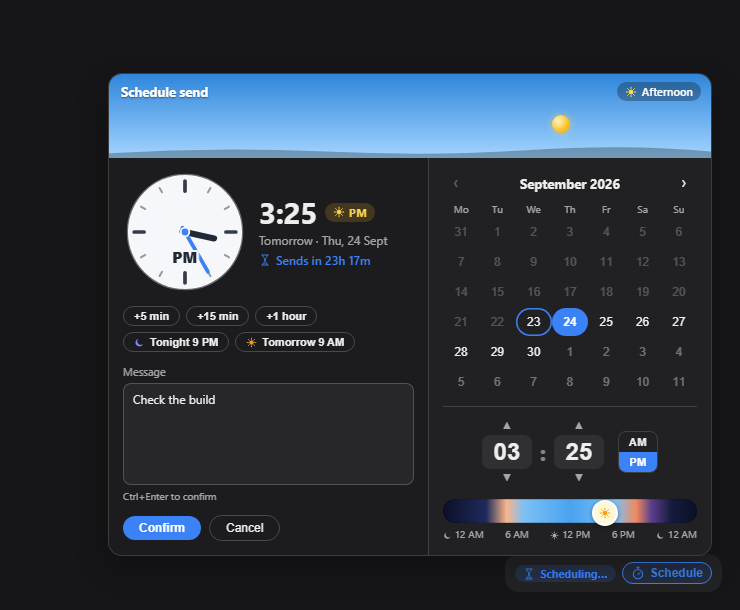
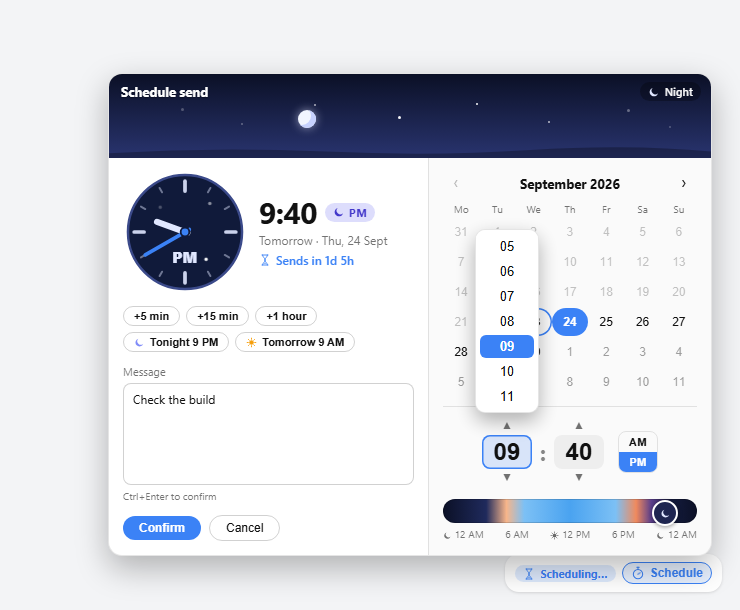
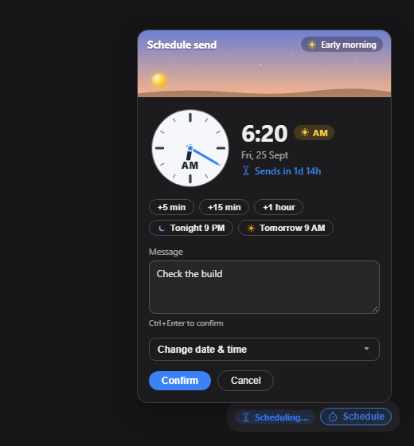
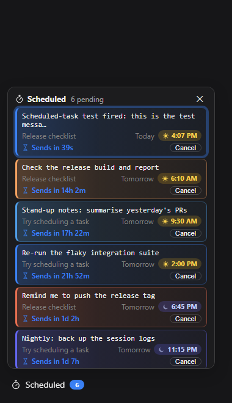

<picture>
  <source media="(prefers-color-scheme: dark)" srcset="assets/banner-dark.png">
  
</picture>

<br>

# dsh-schedule-later

[English](README.md) | 中文

      

一个 [DeepSeek Harness](https://github.com/deepseek-ai/deepseek-harness) 插件，把消息安排到稍后的 dsh 会话里——可以由你在输入框的日期时间选择器里挑选时间，也可以由模型用它自己的工具来安排。

**它运行在宿主端，而不是浏览器里。** 设好时间、关掉标签页、去睡觉：dsh 进程会准时把消息作为**普通用户气泡**发出去，模型回复它就像你亲手按了发送一样。





它做五件事：

- **输入框里的 ⏱️ Schedule 按钮** —— 一个昼夜调度器：天空头部随所选时间变化，配模拟时钟、AM/PM 日月胶囊和快捷选项，与发送按钮同一行。
- **宿主端投递** —— 计时和消息注入都发生在 dsh 宿主进程内，浏览器只是一个视图，标签页关掉也照常工作。
- **“⏱️ Scheduled” 侧边栏面板** —— 列出所有会话里待发的消息，按会话分组、最早优先、按发送时间着色，每条都可以立即发送、改时间或取消。
- **三个模型工具** —— `schedule_message`、`list_scheduled_messages`、`cancel_scheduled_message`，让助手能自己回到会话里。
- **`schedule-later` 技能** —— 教会模型什么时候不用你说就主动安排自己的回访。

## 安装

需要一个可用的、带 `web` profile 的 dsh。

```sh
dsh plugin --profile web add dsh-schedule-later
dsh --profile web
```

也可以从 GitHub 或本地文件夹安装：

```sh
dsh plugin --profile web add github:adithyanraj03/dsh-schedule-later
dsh plugin --profile web add /path/to/dsh-schedule-later
```

然后**重启 dsh**（`dsh --profile web`，如果它正在运行），并**强制刷新浏览器**（Ctrl+Shift+R / Cmd+Shift+R）——普通刷新可能加载缓存的客户端 bundle。输入框一行里会出现 **⏱️ Schedule** 按钮，侧边栏底部会出现 **⏱️ Scheduled** 入口。

### 从 `dsh-send-later` 迁移？

这是同一个插件的正式发布名。**不要在同一个 profile 里同时运行两者**：它们注册同样的三个模型工具和同样的输入框按钮，所以先移除旧的——删掉 profile 的 `cordis.patch.yml` 里的那一行，以及 profile 的 `package.json` 里的条目。

待发消息存放在以插件命名的文件夹里；想保留它们，请在 dsh 停止时把队列复制过来：

```sh
mkdir -p ~/.dsh/dsh-schedule-later
cp ~/.dsh/dsh-send-later/tasks.json ~/.dsh/dsh-schedule-later/tasks.json
```

## 你会得到什么

### 调度器

位于输入框一行、发送按钮旁边。照常输入 → 点击 **⏱️ Schedule** → 调度器打开（默认为 5 分钟后，允许任意未来时间）→ **Confirm** 把草稿变成一条定时消息并清空输入框。**不会立刻发送任何内容。** 多行文本和 Markdown 源码原样保留。

头部是一片随所选时间变化的天空——黎明、白昼、黄昏、夜晚——太阳或月亮沿弧线移动；模拟时钟扫到整点，钟面白天是亮的、夜晚是缀着星星的暗色。时间带着一个**带太阳或月亮的 AM/PM 胶囊**，9:00 PM 永远不会被误当成 9:00 AM。快捷选项：+5 分钟、+15 分钟、+1 小时、今晚 9 点、明早 9 点，下方还有实时的 “Sends in …” 倒计时。





动画生动但不吵闹：设时间时秒表在扫动、悬停时轻弹一下；有待发消息时侧边栏图标缓慢滴答；每次倒计时沙漏都会翻转。系统请求减弱动效时，全部动画停止。

手机和窄窗口（≤480px）下，选择器折叠成接近全宽的弹层，触控目标至少 40px 高：



可以在会话内列表或侧边栏面板里取消任何待发消息——两处都会先向你确认。

### 侧边栏面板

侧边栏底部的入口带着一个统计所有待发消息的徽标，点开是一个列出**所有会话**待发消息的面板——最早优先，每行用等宽字体显示消息（最多两行）、发送时间和倒计时。消息按会话分组——点击会话名即可打开它。点击一条消息看它的详情：全文、是谁在什么时候安排的，以及 Send now、Change time 和 Cancel。Send now 和 Cancel 都会先请求确认。在这里可以取消任何会话的消息。会话已被删除的消息会置灰，但仍可取消。



当前会话的待发消息也会出现在会话内，位于 dsh 的 To-dos 上方（To-dos 紧挨输入框）。多于一条时，只显示最早的一条加一个 “N more scheduled ⌄” 开关；展开的列表在固定高度内滚动，“Collapse ⌃” 开关永远不会滚出视野。任何列表都可以手动折叠。

### 模型工具

三个工具让助手把消息安排进它正在工作的会话——稍后自己回来处理，不用你记着：

| 工具 | 做什么 |
|---|---|
| `schedule_message` | 把一条消息安排进**当前会话**，用 `delay_minutes` 或 ISO 8601 的 `at`（不带时区 = 本机本地时间）。 |
| `list_scheduled_messages` | 列出当前会话里待发的消息——你安排的、助手安排的——以及当前本地时间。 |
| `cancel_scheduled_message` | 取消一条**助手**安排的消息。 |

尽管说 *“remind me at 6pm to push the release”* 或 *“check the CI run again in 20 minutes”*。到点时它作为新一轮对话抵达，模型会直接处理。

护栏——一个能叫醒自己的助手否则可能永远叫下去：

- **仅限当前会话。** 它只能安排进自己正在运行的会话，绝不碰别的会话。
- **明显标记。** 它安排的消息以 `[Scheduled by the assistant]` 开头，没人会把它误当成你实时敲的字。
- **至少提前 1 分钟，最多 30 天，每个会话最多 10 条待发。**
- **它取消不了你的。** 它能列出你安排的消息，但只能取消它自己的。
- 它安排的一切都会出现在 ⏱️ 面板和会话内列表里，你可以取消。

### 技能

插件自带 `schedule-later` 技能（`SKILL.md`），注册到 dsh 的技能服务，模型每一轮都能看到它的目录条目。它教会模型什么时候不用你说就自己回来——还在跑的构建、部署或任务，将会变化的页面或状态，你说过稍后再做的事——怎么写这条消息让未来的自己能冷启动处理，以及告诉你它安排了什么、在什么时候。编辑 `SKILL.md` 即可改变这个行为；每次目录刷新都会重新读取。

## 要求

- 一个 `web` dsh profile —— `engines: dsh >= 0.1.0`
- Node 18+
- 无运行时依赖——客户端 bundle 只依赖 `react`

## 许可证

MIT —— 见 [LICENSE](LICENSE) 文件。
